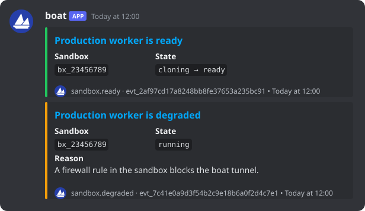

<div align="center">

<a href="https://github.com/bas3line/webhook-relay">
  <picture>
    <source media="(prefers-color-scheme: dark)" srcset="https://ascii.rest/banner/webhook-relay.dark.svg?color=6b8cff,a5b8ff&tagline=boat%20events%2C%20posted%20to%20discord">
    
  </picture>
</a>

<br>
<br>



<br>

[boat](https://boat.dev)'s sandbox webhooks, checked and posted to Discord.<br>
One Cloudflare Worker, no runtime dependencies.

[deploy your own](#deploy-your-own) · [what it posts](#what-it-posts) · [run it locally](#run-it-locally) · [how it works](#how-it-works) · [contributing](CONTRIBUTING.md)

[](https://github.com/bas3line)
[](https://github.com/bas3line/webhook-relay/actions/workflows/ci.yml)
[](LICENSE)
[](tsconfig.json)
[](wrangler.jsonc)

</div>

<br>

Written in TypeScript by [@bas3line](https://github.com/bas3line). boat sends six events about your sandboxes, signed, to any HTTPS endpoint you give it. A Discord webhook only takes Discord's own message format, so pointing boat straight at one gets every delivery refused with `Cannot send an empty message`. This Worker sits between the two: it checks boat's signature, turns each event into a Discord message with boat's logo and a colour for what happened, and tells boat when a post failed so boat sends it again.

## What it posts

| event | message | bar |
| --- | --- | --- |
| `sandbox.ready` | Production worker is ready | green |
| `sandbox.hydrated` | Production worker finished restoring | boat blue |
| `sandbox.error` | Production worker failed | red |
| `sandbox.archived` | Production worker stopped | grey |
| `sandbox.degraded` | Production worker is degraded, and why | amber |
| `sandbox.recovered` | Production worker recovered, and why | teal |

Each message links to the boat dashboard and carries the sandbox ID, the state change (`cloning → ready`), the event ID and the time boat recorded the event. It posts as "boat" with boat's logo, and never pings anyone, whatever a sandbox is called. An event boat adds later still posts, in boat blue, under its own name.

These six are all the webhooks boat has. Commands, their output and agent conversations aren't sent as webhooks: boat's [OpenTelemetry export](https://docs.boat.dev/opentelemetry) and [command history](https://docs.boat.dev/long-running-tasks/command-history) cover those.

## Deploy your own

You need Node 24 or later, a Cloudflare account, the [boat CLI](https://docs.boat.dev/cli-reference) and a Discord channel you can add a webhook to.

```sh
git clone https://github.com/bas3line/webhook-relay
cd webhook-relay
npm install
cp .dev.vars.example .dev.vars
```

1. **Make the Discord webhook.** In the channel's settings: Integrations, Webhooks, New Webhook, Copy Webhook URL. Put it in `.dev.vars` as `DISCORD_WEBHOOK_URL`.
2. **Register the relay with boat.** The Worker will live at `https://webhook-relay.<your-subdomain>.workers.dev`; your subdomain is on the Workers & Pages page of the Cloudflare dashboard. Without `--event`, boat sends all six events.

   ```sh
   boat webhook create https://webhook-relay.<your-subdomain>.workers.dev/boat --name discord
   ```

   boat prints the signing secret, `whsec_...`, once. Put it in `.dev.vars` as `BOAT_WEBHOOK_SECRET`.
3. **Deploy.** A new Worker takes its secrets from a file on the first deploy; later deploys keep them.

   ```sh
   npx wrangler deploy --secrets-file .dev.vars
   ```

4. **Try it.** This signs a sample event with your secret and posts it to the Worker, which posts it to the channel:

   ```sh
   npm run send -- ready https://webhook-relay.<your-subdomain>.workers.dev/boat
   ```

To change a secret later, `npx wrangler secret put DISCORD_WEBHOOK_URL`. To rotate boat's, `boat webhook rotate <id>`, then put the new one the same way.

### Deploy on every push

In the Cloudflare dashboard, open Workers & Pages, the `webhook-relay` Worker, Settings, Builds, and connect your fork. Set the build command to `npm run check` and leave the deploy command as `npx wrangler deploy`. Every push to `main` is typechecked, tested and bundled, then deployed. The secrets stay on the Worker between deploys, and `secrets.required` in `wrangler.jsonc` fails a deploy if either one goes missing, instead of letting the Worker answer every event with an error.

## Run it locally

```sh
npm run dev                  # the Worker on http://localhost:8787
npm run send -- degraded     # a signed sample event, to the Worker on :8787
```

`npm run dev` reads `.dev.vars`. Locally, any `BOAT_WEBHOOK_SECRET` works, as long as `npm run send` signs with the same one.

| script | |
| --- | --- |
| `npm run dev` | the Worker, with `wrangler dev` |
| `npm run send -- <event> [url]` | signs a sample delivery of `ready`, `hydrated`, `error`, `archived`, `degraded` or `recovered` and posts it |
| `npm test` | the tests, with Node's own test runner |
| `npm run check` | typecheck, tests, and the Worker bundled the way Cloudflare will bundle it; what CI runs |
| `npm run deploy` | the checks, then `wrangler deploy` |

## How it works

| route | |
| --- | --- |
| `POST /boat` | a boat delivery. 200 posted, 401 bad signature, 400 not an event, 413 too big, 502 Discord refused it or couldn't be reached |
| `GET /health` | `{"ok":true}`, for uptime checks |

- **Signatures.** boat signs `<delivery id>.<timestamp>.<raw body>` with HMAC-SHA256. The Worker checks the raw bytes before it parses anything, compares in constant time with Web Crypto, and refuses a delivery signed more than five minutes from now. A bad signature is a 401, and nothing reaches Discord.
- **Retries.** A 2xx tells boat the event arrived. When Discord refuses a message or can't be reached, the Worker answers 502 and boat sends the event again with backoff, up to 8 times. The status and Discord's reason show in boat's delivery log and in Workers Logs.
- **At least once.** boat can deliver an event twice, and the Worker keeps no state, so a retried event can post twice. The event ID in the footer tells the two apart.
- **Order.** Events can arrive out of order. Each message is stamped with the time boat recorded the event, not the time it arrived.

```
src/
  index.ts     the Worker: POST /boat and GET /health
  boat.ts      boat's signature check, and the event parser
  discord.ts   an event as a Discord message
  config.ts    boat's logo and dashboard, and the sentence and colour for each event
  http.ts      JSON responses and log lines
  samples.ts   one delivery of each event, for the tests and npm run send
  *.test.ts    the tests, beside what they test
scripts/
  send.ts      signs a sample delivery and posts it
```

TypeScript, run by Node directly for the tests and scripts, and bundled by Wrangler for the Worker. The Worker uses only web APIs (`fetch`, Web Crypto, `TextEncoder`), so there's nothing to install at runtime.

## Contributing

Fixes and ideas are welcome, and so are other sources and destinations. [CONTRIBUTING.md](CONTRIBUTING.md) covers the setup, the checks, how a new one fits in and how to open a pull request, and the [code of conduct](CODE_OF_CONDUCT.md) applies everywhere. Found a security problem? See [SECURITY.md](SECURITY.md).

## Author

Made by [@bas3line](https://github.com/bas3line). If you use it, a link back is appreciated, and so is a star.

To support it: [GitHub Sponsors](https://github.com/sponsors/bas3line), [Buy Me a Coffee](https://buymeacoffee.com/bas3line) or [PayPal](https://paypal.me/ShubhamYadav886).

## License

The code is MIT, © [@bas3line](https://github.com/bas3line). boat's name and logo belong to boat. The relay links the logo from boat.dev to name the product, and isn't made by or affiliated with boat.
